SINDy on the mean-pooled Aurora latents, 25 events (Aashish 9, Aabhwan 8, Abdul 8). Code: geo_ft/sindy_events.py

# Team SINDy results: 25 events, shared PCA basis

**Who ran what:** Aashish 9 events (great_atlantic_hurricane_1944, katrina_2005, andrew_1992, mitch_1998, ivan_2004, tip_1979, bangladesh_1991_1991, wilma_2005, odisha_1999_1999), Aabhwan 8 (irma_2017, maria_2017, dorian_2019, iota_2020, hugo_1989, nargis_2008, haiyan_2013, sandy_2012), Abdul 8 (hazel_1954, donna_1960, camille_1969, fifi_1974, vera_1959, nina_1975, bhola_1970, harvey_2017). Commands exactly as in `SINDY_TEAM.md`; basis `sindy_basis/` (event-mean anomalies).

## Summary for the advisor

1. 25 events (Aashish 9, Aabhwan 8, Abdul 8) were fitted on one shared PCA basis with identical, verified settings; two events per teammate were rerun locally and reproduce to < 1e-14.
2. Continuous-time (6-hourly) SINDy finds essentially nothing per event: 0/25 non-empty models for the encoder runs and 4-5/25 for the backbone runs, none reliably beating the zero-derivative baseline (pooled combined held-out R2 only 0.007-0.021).
3. Discrete-time maps show an apparent signal (regional encoder, k=3: beats the no-change baseline on 20/23 non-empty events, median held-out R2 0.41; combined 6-term model held-out R2 0.60 on the increment; across the regional discrete runs R2 is about 0.4-0.6), but it is not storm dynamics. It is a fixed time-of-day pattern at 00/06/12/18 UTC: it disappears when the per-hour mean is removed (`event_diurnal` anomaly check, held-out R2 <= 0.003; see `geo_ft/sindy_study/discrete_event_diurnal_check.md` in the code repo). Read the discrete R2 values below with this in mind.
4. Per-event models agree with each other and with the combined model mainly in the k=3 regional encoder (Jaccard vs combined 0.78, pairwise 0.75), but that agreement is the same fixed time-of-day pattern as in point 3, not shared storm dynamics. In the other discrete runs the term overlap is low (0.17-0.32 vs combined) and the combined models are dense (17-25 terms), so equations differ across events.
5. Pre-1979 (n=8) and post-1979 (n=17) events do not differ detectably in held-out R2 (all Mann-Whitney p > 0.4), so there is no sign that the older events behave differently, though 8 events gives little power.


## Checks done before merging

- Both zips extracted with no unsafe paths (no absolute paths, `..`, drive letters or symlinks); each has 5 run folders x 8 events.
- All 125 `config.json` files (8+8+9 events x 5 runs) match the SINDY_TEAM.md settings (k, library, control, discrete, `threshold_mode=cv`, `event_mean` anomaly, holdout 0.25, ...) and each other. The `threshold` field in config.json is the unused fixed-mode default (0.01); the CV-chosen threshold is in `metrics.csv`.
- Reproducibility: reran irma_2017 and hugo_1989 (Aabhwan) and hazel_1954 and harvey_2017 (Abdul) for all 5 runs on this machine. All metrics.csv and coefficients.csv values agree to < 1e-14; equations and config.json agree exactly apart from CRLF vs LF line endings.
- Merged into `team/<run>/` (25 event folders each), ran `combined` per run with the same settings, then `compare`.

## Reading the tables

- *Baseline* = predict zero derivative (6-hourly runs) or zero increment z(t+1)-z(t) (discrete runs); R2 is 0 for it by construction, so held-out R2 > 0 means the model beats the baseline. Held-out = model refit on the first 75% of each event, scored on the last 25%.
- *active terms* = non-zero coefficients after CV-chosen STLSQ; `empty` means CV found nothing predictable. The heatmaps and Jaccard matrices only carry information for non-empty models, so Jaccard medians are over non-empty events.
- *combined* = one model fitted to all 25 events as separate trajectories (held-out: refit on the first 75% of every event). "combined held-out R2" in the per-event tables is that model scored on the event's own last 25%.
- Discrete-run R2 is on the increment z(t+1)-z(t), so it is not directly comparable with the 6-hourly runs.

## Main table: all runs

> **Caveat:** the discrete-time R2 values (`discrete_k5`, `discrete_k3`) reflect a fixed 00/06/12/18 UTC time-of-day pattern, not storm dynamics; the signal vanishes with the per-hour mean removed (see `geo_ft/sindy_study/discrete_event_diurnal_check.md` in the code repo).

| run | combo | events | own models non-empty | own beats baseline | median own ho R2 (all 25) | median own ho R2 (non-empty) | combined ho R2 (pooled) | combined active | combined beats baseline on |
|---|---|---|---|---|---|---|---|---|---|
| 6h_d1_enc | d1_enc | 25 | 0/25 | 0/0 | -0.260 | n/a | 0.021 | 15 | 3/25 |
| 6h_d1_bb | d1_bb | 25 | 4/25 | 0/4 | -0.315 | -0.154 | 0.008 | 6 | 4/25 |
| 6h_d2 | d2_enc | 25 | 0/25 | 0/0 | -0.117 | n/a | 0.007 | 10 | 8/25 |
| 6h_d2 | d2_bb | 25 | 5/25 | 1/5 | -0.189 | -0.135 | 0.015 | 7 | 6/25 |
| discrete_k5 | d1_enc | 25 | 19/25 | 4/19 | -0.479 | -0.425 | 0.128 | 24 | 17/25 |
| discrete_k5 | d1_bb | 25 | 16/25 | 5/16 | -0.086 | -0.057 | 0.138 | 25 | 19/25 |
| discrete_k5 | d2_bb | 25 | 23/25 | 11/23 | 0.015 | -0.009 | 0.382 | 17 | 23/25 |
| discrete_k3 | d2_enc | 25 | 23/25 | 20/23 | 0.411 | 0.436 | 0.598 | 6 | 22/25 |


## Per-event tables

### 6h_d1_enc / d1_enc (6-hourly SINDy, k=5, poly2)

| event | runner | active terms | own held-out R2 | combined held-out R2 | own held-out sim nRMSE | own beats baseline |
|---|---|---|---|---|---|---|
| andrew_1992 | aashish | 0 | -0.118 | -0.051 | 0.725 | empty |
| bangladesh_1991_1991 | aashish | 0 | -1.654 | -1.622 | 0.975 | empty |
| bhola_1970 | abdul | 0 | -0.117 | -0.137 | 0.817 | empty |
| camille_1969 | abdul | 0 | -0.295 | -0.159 | 0.859 | empty |
| donna_1960 | abdul | 0 | -0.774 | -0.774 | 0.807 | empty |
| dorian_2019 | aabhwan | 0 | -0.178 | -0.087 | 0.692 | empty |
| fifi_1974 | abdul | 0 | -0.143 | -0.343 | 0.682 | empty |
| great_atlantic_hurricane_1944 | aashish | 0 | -3.367 | -3.751 | 1.364 | empty |
| haiyan_2013 | aabhwan | 0 | -0.303 | -0.279 | 0.720 | empty |
| harvey_2017 | abdul | 0 | -0.395 | -0.275 | 0.916 | empty |
| hazel_1954 | abdul | 0 | -0.231 | -0.265 | 0.925 | empty |
| hugo_1989 | aabhwan | 0 | -0.047 | 0.012 | 0.838 | empty |
| iota_2020 | aabhwan | 0 | -0.035 | -0.033 | 0.829 | empty |
| irma_2017 | aabhwan | 0 | -0.720 | -1.444 | 0.779 | empty |
| ivan_2004 | aashish | 0 | -0.648 | -0.702 | 0.433 | empty |
| katrina_2005 | aashish | 0 | -4.465 | -0.229 | 0.734 | empty |
| maria_2017 | aabhwan | 0 | -0.237 | -0.207 | 0.478 | empty |
| mitch_1998 | aashish | 0 | -1.065 | -1.170 | 0.959 | empty |
| nargis_2008 | aabhwan | 0 | -0.444 | 0.143 | 0.881 | empty |
| nina_1975 | abdul | 0 | -0.149 | -0.063 | 1.317 | empty |
| odisha_1999_1999 | aashish | 0 | -0.190 | -0.044 | 0.786 | empty |
| sandy_2012 | aabhwan | 0 | -1.745 | -0.827 | 1.115 | empty |
| tip_1979 | aashish | 0 | -0.260 | -0.159 | 0.531 | empty |
| vera_1959 | abdul | 0 | -0.114 | 0.021 | 0.859 | empty |
| wilma_2005 | aashish | 0 | -0.117 | -0.037 | 0.863 | empty |

### 6h_d1_bb / d1_bb (6-hourly SINDy, k=5, poly2, diurnal control)

| event | runner | active terms | own held-out R2 | combined held-out R2 | own held-out sim nRMSE | own beats baseline |
|---|---|---|---|---|---|---|
| andrew_1992 | aashish | 1 | -0.152 | -0.230 | 0.982 | no |
| bangladesh_1991_1991 | aashish | 0 | -8.725 | -0.907 | 0.910 | empty |
| bhola_1970 | abdul | 0 | -0.110 | 0.039 | 0.844 | empty |
| camille_1969 | abdul | 0 | -0.624 | -0.516 | 0.810 | empty |
| donna_1960 | abdul | 0 | -0.647 | -0.642 | 0.674 | empty |
| dorian_2019 | aabhwan | 0 | -0.025 | -0.128 | 0.679 | empty |
| fifi_1974 | abdul | 0 | -0.048 | -0.020 | 0.811 | empty |
| great_atlantic_hurricane_1944 | aashish | 1 | -1.666 | -2.466 | 1.288 | no |
| haiyan_2013 | aabhwan | 1 | -0.156 | -0.154 | 0.562 | no |
| harvey_2017 | abdul | 0 | -0.070 | 0.073 | 1.025 | empty |
| hazel_1954 | abdul | 0 | -0.287 | -0.275 | 0.792 | empty |
| hugo_1989 | aabhwan | 0 | -0.109 | 0.026 | 0.934 | empty |
| iota_2020 | aabhwan | 1 | -0.119 | 0.007 | 0.764 | no |
| irma_2017 | aabhwan | 0 | -0.732 | -0.977 | 0.849 | empty |
| ivan_2004 | aashish | 0 | -0.262 | -0.221 | 0.583 | empty |
| katrina_2005 | aashish | 0 | -3.882 | -1.123 | 1.207 | empty |
| maria_2017 | aabhwan | 0 | -0.213 | -0.391 | 0.520 | empty |
| mitch_1998 | aashish | 0 | -2.515 | -2.427 | 0.796 | empty |
| nargis_2008 | aabhwan | 0 | -1.025 | -0.285 | 0.576 | empty |
| nina_1975 | abdul | 0 | -1.064 | -1.002 | 0.893 | empty |
| odisha_1999_1999 | aashish | 0 | -0.315 | -0.220 | 0.548 | empty |
| sandy_2012 | aabhwan | 0 | -0.580 | -0.413 | 1.297 | empty |
| tip_1979 | aashish | 0 | -0.426 | -0.390 | 0.700 | empty |
| vera_1959 | abdul | 0 | -0.585 | -0.594 | 0.849 | empty |
| wilma_2005 | aashish | 0 | -0.308 | -0.139 | 0.917 | empty |

### 6h_d2 / d2_enc (6-hourly SINDy, k=3, poly1)

| event | runner | active terms | own held-out R2 | combined held-out R2 | own held-out sim nRMSE | own beats baseline |
|---|---|---|---|---|---|---|
| andrew_1992 | aashish | 0 | -0.081 | -0.010 | 1.380 | empty |
| bangladesh_1991_1991 | aashish | 0 | -0.151 | -0.117 | 0.911 | empty |
| bhola_1970 | abdul | 0 | -0.098 | -0.206 | 1.214 | empty |
| camille_1969 | abdul | 0 | -0.127 | -0.066 | 1.472 | empty |
| donna_1960 | abdul | 0 | -0.038 | 0.043 | 1.078 | empty |
| dorian_2019 | aabhwan | 0 | -0.004 | 0.015 | 1.285 | empty |
| fifi_1974 | abdul | 0 | 0.015 | 0.032 | 1.388 | empty |
| great_atlantic_hurricane_1944 | aashish | 0 | -0.690 | -0.634 | 1.411 | empty |
| haiyan_2013 | aabhwan | 0 | -0.215 | -0.148 | 1.041 | empty |
| harvey_2017 | abdul | 0 | -0.012 | 0.042 | 1.157 | empty |
| hazel_1954 | abdul | 0 | -0.117 | -0.191 | 0.858 | empty |
| hugo_1989 | aabhwan | 0 | -0.089 | -0.105 | 0.814 | empty |
| iota_2020 | aabhwan | 0 | -0.092 | -0.117 | 0.872 | empty |
| irma_2017 | aabhwan | 0 | -0.100 | 0.009 | 1.473 | empty |
| ivan_2004 | aashish | 0 | -0.304 | 0.001 | 1.154 | empty |
| katrina_2005 | aashish | 0 | -0.208 | -0.243 | 0.999 | empty |
| maria_2017 | aabhwan | 0 | -0.020 | 0.009 | 1.243 | empty |
| mitch_1998 | aashish | 0 | -0.004 | 0.128 | 1.035 | empty |
| nargis_2008 | aabhwan | 0 | -0.191 | -0.237 | 0.802 | empty |
| nina_1975 | abdul | 0 | -0.176 | -0.177 | 1.022 | empty |
| odisha_1999_1999 | aashish | 0 | -0.205 | -0.127 | 0.933 | empty |
| sandy_2012 | aabhwan | 0 | -0.052 | -0.131 | 0.519 | empty |
| tip_1979 | aashish | 0 | -0.410 | -0.401 | 1.096 | empty |
| vera_1959 | abdul | 0 | -0.144 | -0.107 | 1.549 | empty |
| wilma_2005 | aashish | 0 | -0.280 | -0.064 | 1.192 | empty |

### 6h_d2 / d2_bb (6-hourly SINDy, k=3, poly1)

| event | runner | active terms | own held-out R2 | combined held-out R2 | own held-out sim nRMSE | own beats baseline |
|---|---|---|---|---|---|---|
| andrew_1992 | aashish | 5 | -0.617 | -0.488 | 1.197 | no |
| bangladesh_1991_1991 | aashish | 1 | -0.128 | -0.197 | 0.987 | no |
| bhola_1970 | abdul | 0 | -0.160 | -0.048 | 1.008 | empty |
| camille_1969 | abdul | 0 | -0.494 | -0.047 | 1.647 | empty |
| donna_1960 | abdul | 0 | -0.048 | -0.042 | 1.029 | empty |
| dorian_2019 | aabhwan | 0 | -0.081 | 0.093 | 1.250 | empty |
| fifi_1974 | abdul | 0 | -0.009 | 0.011 | 1.480 | empty |
| great_atlantic_hurricane_1944 | aashish | 0 | -1.025 | -1.335 | 1.179 | empty |
| haiyan_2013 | aabhwan | 0 | -0.209 | -0.129 | 0.878 | empty |
| harvey_2017 | abdul | 0 | -0.093 | -0.016 | 1.213 | empty |
| hazel_1954 | abdul | 2 | -0.135 | 0.023 | 0.610 | no |
| hugo_1989 | aabhwan | 0 | -0.106 | -0.238 | 0.727 | empty |
| iota_2020 | aabhwan | 3 | -0.189 | -0.517 | 1.261 | no |
| irma_2017 | aabhwan | 0 | -0.388 | -0.396 | 1.333 | empty |
| ivan_2004 | aashish | 0 | -0.047 | 0.077 | 0.866 | empty |
| katrina_2005 | aashish | 0 | -0.330 | -0.438 | 0.671 | empty |
| maria_2017 | aabhwan | 3 | 0.012 | 0.018 | 0.925 | yes |
| mitch_1998 | aashish | 0 | -0.017 | 0.063 | 0.796 | empty |
| nargis_2008 | aabhwan | 0 | -0.735 | -0.417 | 0.560 | empty |
| nina_1975 | abdul | 0 | -0.471 | -0.085 | 0.980 | empty |
| odisha_1999_1999 | aashish | 0 | -0.250 | -0.394 | 0.551 | empty |
| sandy_2012 | aabhwan | 0 | -0.052 | -0.282 | 0.595 | empty |
| tip_1979 | aashish | 0 | -0.569 | -0.269 | 1.503 | empty |
| vera_1959 | abdul | 0 | -0.936 | -0.192 | 1.183 | empty |
| wilma_2005 | aashish | 0 | -0.200 | -0.029 | 0.563 | empty |

### discrete_k5 / d1_enc (discrete map z(t+1)=f(z(t)), k=5, poly1)

> **Caveat:** the discrete-time R2 values (`discrete_k5`, `discrete_k3`) reflect a fixed 00/06/12/18 UTC time-of-day pattern, not storm dynamics; the signal vanishes with the per-hour mean removed (see `geo_ft/sindy_study/discrete_event_diurnal_check.md` in the code repo).

| event | runner | active terms | own held-out R2 | combined held-out R2 | own held-out sim nRMSE | own beats baseline |
|---|---|---|---|---|---|---|
| andrew_1992 | aashish | 5 | -1.114 | 0.235 | 0.933 | no |
| bangladesh_1991_1991 | aashish | 2 | -0.756 | 0.134 | 0.823 | no |
| bhola_1970 | abdul | 0 | -2.396 | 0.116 | 0.966 | empty |
| camille_1969 | abdul | 2 | -0.911 | -0.179 | 0.924 | no |
| donna_1960 | abdul | 2 | 0.035 | 0.043 | 0.796 | yes |
| dorian_2019 | aabhwan | 3 | 0.114 | 0.186 | 0.623 | yes |
| fifi_1974 | abdul | 4 | -0.793 | 0.249 | 0.869 | no |
| great_atlantic_hurricane_1944 | aashish | 0 | -0.610 | -0.392 | 1.235 | empty |
| haiyan_2013 | aabhwan | 3 | -0.138 | -0.266 | 0.763 | no |
| harvey_2017 | abdul | 1 | -1.685 | -0.090 | 1.326 | no |
| hazel_1954 | abdul | 5 | -1.658 | 0.265 | 0.972 | no |
| hugo_1989 | aabhwan | 2 | -0.479 | 0.204 | 0.890 | no |
| iota_2020 | aabhwan | 3 | -0.425 | 0.256 | 0.898 | no |
| irma_2017 | aabhwan | 2 | -0.086 | 0.156 | 0.641 | no |
| ivan_2004 | aashish | 3 | 0.159 | 0.229 | 0.495 | yes |
| katrina_2005 | aashish | 3 | -10.914 | 0.128 | 1.057 | no |
| maria_2017 | aabhwan | 11 | -0.044 | 0.146 | 0.843 | no |
| mitch_1998 | aashish | 0 | -0.130 | -0.967 | 0.881 | empty |
| nargis_2008 | aabhwan | 1 | -0.092 | -0.409 | 0.891 | no |
| nina_1975 | abdul | 12 | -0.161 | 0.216 | 1.248 | no |
| odisha_1999_1999 | aashish | 1 | -0.790 | -0.288 | 1.144 | no |
| sandy_2012 | aabhwan | 0 | -0.504 | -0.131 | 0.866 | empty |
| tip_1979 | aashish | 0 | -1.425 | 0.232 | 0.965 | empty |
| vera_1959 | abdul | 1 | 0.118 | 0.220 | 0.851 | yes |
| wilma_2005 | aashish | 0 | -0.160 | 0.066 | 0.608 | empty |

### discrete_k5 / d1_bb (discrete map z(t+1)=f(z(t)), k=5, poly1)

> **Caveat:** the discrete-time R2 values (`discrete_k5`, `discrete_k3`) reflect a fixed 00/06/12/18 UTC time-of-day pattern, not storm dynamics; the signal vanishes with the per-hour mean removed (see `geo_ft/sindy_study/discrete_event_diurnal_check.md` in the code repo).

| event | runner | active terms | own held-out R2 | combined held-out R2 | own held-out sim nRMSE | own beats baseline |
|---|---|---|---|---|---|---|
| andrew_1992 | aashish | 8 | 0.001 | 0.202 | 1.878 | yes |
| bangladesh_1991_1991 | aashish | 6 | -0.429 | 0.058 | 1.392 | no |
| bhola_1970 | abdul | 3 | 0.180 | 0.208 | 0.873 | yes |
| camille_1969 | abdul | 0 | -0.178 | -0.091 | 0.762 | empty |
| donna_1960 | abdul | 0 | 0.040 | -0.080 | 0.639 | empty |
| dorian_2019 | aabhwan | 2 | 0.212 | 0.135 | 0.638 | yes |
| fifi_1974 | abdul | 3 | 0.293 | 0.274 | 0.665 | yes |
| great_atlantic_hurricane_1944 | aashish | 4 | -0.628 | -0.881 | 1.335 | no |
| haiyan_2013 | aabhwan | 1 | -0.013 | 0.142 | 0.538 | no |
| harvey_2017 | abdul | 6 | -0.017 | 0.168 | 0.851 | no |
| hazel_1954 | abdul | 0 | 0.001 | 0.006 | 0.795 | empty |
| hugo_1989 | aabhwan | 0 | -0.140 | -0.124 | 0.915 | empty |
| iota_2020 | aabhwan | 1 | 0.051 | 0.184 | 0.750 | yes |
| irma_2017 | aabhwan | 0 | -1.296 | -0.026 | 1.199 | empty |
| ivan_2004 | aashish | 0 | -0.070 | 0.052 | 0.645 | empty |
| katrina_2005 | aashish | 6 | -0.503 | -0.628 | 1.136 | no |
| maria_2017 | aabhwan | 7 | -0.063 | 0.126 | 0.675 | no |
| mitch_1998 | aashish | 0 | -0.255 | 0.042 | 0.868 | empty |
| nargis_2008 | aabhwan | 1 | -0.177 | 0.038 | 1.035 | no |
| nina_1975 | abdul | 3 | -7.123 | 0.230 | 1.122 | no |
| odisha_1999_1999 | aashish | 1 | -0.775 | 0.047 | 0.694 | no |
| sandy_2012 | aabhwan | 25 | -0.051 | 0.156 | 0.978 | no |
| tip_1979 | aashish | 0 | -0.889 | 0.224 | 0.748 | empty |
| vera_1959 | abdul | 0 | -1.640 | 0.188 | 1.654 | empty |
| wilma_2005 | aashish | 6 | -0.086 | 0.070 | 0.879 | no |

### discrete_k5 / d2_bb (discrete map z(t+1)=f(z(t)), k=5, poly1)

> **Caveat:** the discrete-time R2 values (`discrete_k5`, `discrete_k3`) reflect a fixed 00/06/12/18 UTC time-of-day pattern, not storm dynamics; the signal vanishes with the per-hour mean removed (see `geo_ft/sindy_study/discrete_event_diurnal_check.md` in the code repo).

| event | runner | active terms | own held-out R2 | combined held-out R2 | own held-out sim nRMSE | own beats baseline |
|---|---|---|---|---|---|---|
| andrew_1992 | aashish | 1 | -1.508 | 0.337 | 0.922 | no |
| bangladesh_1991_1991 | aashish | 20 | -0.451 | 0.447 | 0.820 | no |
| bhola_1970 | abdul | 2 | -2.839 | 0.598 | 1.259 | no |
| camille_1969 | abdul | 3 | -0.769 | 0.118 | 4.830 | no |
| donna_1960 | abdul | 10 | 0.159 | 0.299 | 1.033 | yes |
| dorian_2019 | aabhwan | 9 | -0.199 | 0.337 | 1.067 | no |
| fifi_1974 | abdul | 5 | 0.039 | 0.492 | 1.146 | yes |
| great_atlantic_hurricane_1944 | aashish | 2 | 0.128 | 0.252 | 0.799 | yes |
| haiyan_2013 | aabhwan | 16 | -0.713 | 0.326 | 1.318 | no |
| harvey_2017 | abdul | 9 | 0.172 | 0.281 | 0.870 | yes |
| hazel_1954 | abdul | 1 | 0.024 | 0.028 | 0.677 | yes |
| hugo_1989 | aabhwan | 14 | -0.059 | 0.323 | 0.897 | no |
| iota_2020 | aabhwan | 3 | -0.009 | -0.302 | 1.140 | no |
| irma_2017 | aabhwan | 4 | 0.353 | 0.371 | 0.877 | yes |
| ivan_2004 | aashish | 1 | -1.608 | 0.233 | 0.950 | no |
| katrina_2005 | aashish | 2 | 0.032 | 0.074 | 0.974 | yes |
| maria_2017 | aabhwan | 0 | 0.412 | 0.505 | 1.164 | empty |
| mitch_1998 | aashish | 2 | -0.718 | 0.195 | 1.300 | no |
| nargis_2008 | aabhwan | 3 | -5.866 | 0.512 | 1.264 | no |
| nina_1975 | abdul | 10 | 0.070 | 0.349 | 0.823 | yes |
| odisha_1999_1999 | aashish | 21 | 0.564 | 0.483 | 0.584 | yes |
| sandy_2012 | aabhwan | 1 | 0.028 | -0.342 | 0.625 | yes |
| tip_1979 | aashish | 0 | 0.098 | 0.209 | 1.107 | empty |
| vera_1959 | abdul | 12 | -0.337 | 0.293 | 1.455 | no |
| wilma_2005 | aashish | 2 | 0.015 | 0.004 | 0.541 | yes |

### discrete_k3 / d2_enc (discrete map, k=3, poly1)

> **Caveat:** the discrete-time R2 values (`discrete_k5`, `discrete_k3`) reflect a fixed 00/06/12/18 UTC time-of-day pattern, not storm dynamics; the signal vanishes with the per-hour mean removed (see `geo_ft/sindy_study/discrete_event_diurnal_check.md` in the code repo).

| event | runner | active terms | own held-out R2 | combined held-out R2 | own held-out sim nRMSE | own beats baseline |
|---|---|---|---|---|---|---|
| andrew_1992 | aashish | 6 | 0.087 | 0.372 | 1.293 | yes |
| bangladesh_1991_1991 | aashish | 5 | 0.563 | 0.640 | 0.744 | yes |
| bhola_1970 | abdul | 9 | 0.375 | 0.790 | 1.059 | yes |
| camille_1969 | abdul | 0 | -3.430 | -0.069 | 1.593 | empty |
| donna_1960 | abdul | 6 | 0.361 | 0.413 | 1.152 | yes |
| dorian_2019 | aabhwan | 6 | 0.347 | 0.482 | 1.214 | yes |
| fifi_1974 | abdul | 5 | 0.516 | 0.625 | 1.128 | yes |
| great_atlantic_hurricane_1944 | aashish | 9 | 0.296 | 0.613 | 0.963 | yes |
| haiyan_2013 | aabhwan | 5 | 0.411 | 0.821 | 1.446 | yes |
| harvey_2017 | abdul | 4 | 0.513 | 0.199 | 0.885 | yes |
| hazel_1954 | abdul | 6 | 0.194 | 0.290 | 0.820 | yes |
| hugo_1989 | aabhwan | 6 | 0.519 | 0.622 | 0.953 | yes |
| iota_2020 | aabhwan | 3 | -1.586 | -0.530 | 1.250 | no |
| irma_2017 | aabhwan | 5 | 0.638 | 0.644 | 0.835 | yes |
| ivan_2004 | aashish | 5 | -1.350 | 0.423 | 1.259 | no |
| katrina_2005 | aashish | 8 | 0.333 | 0.303 | 1.192 | yes |
| maria_2017 | aabhwan | 6 | 0.742 | 0.740 | 1.177 | yes |
| mitch_1998 | aashish | 6 | 0.466 | 0.502 | 0.844 | yes |
| nargis_2008 | aabhwan | 2 | 0.826 | 0.742 | 0.743 | yes |
| nina_1975 | abdul | 9 | 0.436 | 0.419 | 0.975 | yes |
| odisha_1999_1999 | aashish | 6 | 0.502 | 0.708 | 1.288 | yes |
| sandy_2012 | aabhwan | 4 | -0.310 | -0.463 | 0.973 | no |
| tip_1979 | aashish | 6 | 0.750 | 0.569 | 0.998 | yes |
| vera_1959 | abdul | 6 | 0.740 | 0.731 | 1.305 | yes |
| wilma_2005 | aashish | 0 | -1.285 | 0.108 | 1.407 | empty |

## Combined models

Equations are in PC coordinates of the shared basis (`(z0)'` = continuous time per day; `z0[k+1]` = discrete map). Held-out R2 is pooled over the last 25% of all events.

### 6h_d1_enc / d1_enc: 15 active terms, threshold 0.03, in-sample R2 0.103, **held-out R2 0.021**, held-out sim nRMSE 0.596

```
== combined (25 events) | d1_enc | n=2567 active=15 thr=0.03 deriv_R2=0.103 heldout_R2=0.021 heldout_sim=0.596
(z0)' = -0.093 1 -0.047 z1
(z1)' = +0.036 z0 -0.065 z2 +0.210 z3 +0.101 z4 -0.049 z1 z3
(z2)' = +0.069 z1 -0.050 z0 z2
(z3)' = -0.190 z1 +0.044 z0^2 -0.045 z0 z3
(z4)' = -0.105 z1 -0.051 z2 +0.036 z2 z3
```

### 6h_d1_bb / d1_bb: 6 active terms, threshold 0.1, in-sample R2 0.015, **held-out R2 0.008**, held-out sim nRMSE 0.778

```
== combined (25 events) | d1_bb | n=2567 active=6 thr=0.1 deriv_R2=0.015 heldout_R2=0.008 heldout_sim=0.778
(z0)' = 0
(z1)' = +0.292 z4 -0.162 us -0.173 us^2 +0.159 uc^2
(z2)' = 0
(z3)' = 0
(z4)' = -0.161 z1 -0.101 uc
```

### 6h_d2 / d2_enc: 10 active terms, threshold 0.03, in-sample R2 0.051, **held-out R2 0.007**, held-out sim nRMSE 1.077

```
== combined (25 events) | d2_enc | n=2567 active=10 thr=0.03 deriv_R2=0.051 heldout_R2=0.007 heldout_sim=1.077
(z0)' = -0.057 1 +0.037 z1 -0.033 z2
(z1)' = +0.032 1 -0.064 z0 -0.162 z2
(z2)' = -0.060 1 +0.038 z0 +0.155 z1 -0.043 z2
```

### 6h_d2 / d2_bb: 7 active terms, threshold 0.03, in-sample R2 0.055, **held-out R2 0.015**, held-out sim nRMSE 0.749

```
== combined (25 events) | d2_bb | n=2567 active=7 thr=0.03 deriv_R2=0.055 heldout_R2=0.015 heldout_sim=0.749
(z0)' = -0.047 1 -0.048 z1 -0.129 z2
(z1)' = +0.046 z0 -0.081 z2
(z2)' = +0.151 z0 +0.080 z1
```

### discrete_k5 / d1_enc: 24 active terms, threshold 0.001, in-sample R2 0.195, **held-out R2 0.128**, held-out sim nRMSE 0.796

```
== combined (25 events) | d1_enc | n=2542 active=24 thr=0.001 deriv_R2=0.195 heldout_R2=0.128 heldout_sim=0.796
z0[k+1] = -0.024 1 +0.983 z0 -0.017 z1 +0.031 z2 -0.061 z3 -0.028 z4
z1[k+1] = -0.004 1 +0.007 z0 +0.982 z1 +0.012 z3 +0.011 z4
z2[k+1] = -0.007 1 +0.033 z0 +0.039 z1 +0.906 z2 +0.149 z3 +0.063 z4
z3[k+1] = +0.010 1 -0.044 z0 -0.101 z1 +0.156 z2 +0.663 z3 -0.158 z4
z4[k+1] = +0.001 1 -0.065 z0 -0.060 z1 +0.135 z2 -0.265 z3 +0.762 z4
```

### discrete_k5 / d1_bb: 25 active terms, threshold 0.001, in-sample R2 0.215, **held-out R2 0.138**, held-out sim nRMSE 0.699

```
== combined (25 events) | d1_bb | n=2542 active=25 thr=0.001 deriv_R2=0.215 heldout_R2=0.138 heldout_sim=0.699
z0[k+1] = -0.024 1 +0.989 z0 -0.017 z1 -0.006 z2 -0.007 z3 -0.007 z4
z1[k+1] = -0.002 1 +0.010 z0 +0.987 z1 -0.006 z2 -0.013 z3 +0.014 z4
z2[k+1] = -0.001 1 -0.023 z0 -0.006 z1 +0.890 z2 +0.025 z3 -0.296 z4
z3[k+1] = -0.007 1 +0.018 z0 +0.018 z1 -0.009 z2 +0.989 z3 +0.009 z4
z4[k+1] = -0.011 1 -0.086 z0 -0.073 z1 -0.266 z2 +0.050 z3 +0.079 z4
```

### discrete_k5 / d2_bb: 17 active terms, threshold 0.03, in-sample R2 0.417, **held-out R2 0.382**, held-out sim nRMSE 0.713

```
== combined (25 events) | d2_bb | n=2542 active=17 thr=0.03 deriv_R2=0.417 heldout_R2=0.382 heldout_sim=0.713
z0[k+1] = +0.853 z0 +0.085 z1 -0.052 z2 +0.200 z3 -0.074 z4
z1[k+1] = +0.098 z0 +0.749 z1 -0.035 z2 -0.213 z3
z2[k+1] = +0.141 z0 +0.930 z2 -0.234 z3 +0.098 z4
z3[k+1] = +0.416 z0 -0.318 z1 -0.058 z2 +0.144 z3 +0.247 z4
z4[k+1] = -0.103 z0 +0.038 z1 +0.224 z3 +0.881 z4
```

### discrete_k3 / d2_enc: 6 active terms, threshold 0.1, in-sample R2 0.617, **held-out R2 0.598**, held-out sim nRMSE 0.877

```
== combined (25 events) | d2_enc | n=2542 active=6 thr=0.1 deriv_R2=0.617 heldout_R2=0.598 heldout_sim=0.877
z0[k+1] = +0.636 z0 -0.335 z1 +0.300 z2
z1[k+1] = -0.490 z0 +0.299 z1 +0.532 z2
z2[k+1] = +0.537 z0 +0.395 z1 +0.326 z2
```

## Per-event vs combined term overlap

| run | combo | median active (own) | combined active | median Jaccard vs combined (non-empty) | median pairwise Jaccard (non-empty) |
|---|---|---|---|---|---|
| 6h_d1_enc | d1_enc | 0.0 | 15 | n/a | n/a |
| 6h_d1_bb | d1_bb | 0.0 | 6 | 0.000 | 0.000 |
| 6h_d2 | d2_enc | 0.0 | 10 | n/a | n/a |
| 6h_d2 | d2_bb | 0.0 | 7 | 0.429 | 0.333 |
| discrete_k5 | d1_enc | 2.0 | 24 | 0.207 | 0.500 |
| discrete_k5 | d1_bb | 1.0 | 25 | 0.167 | 0.545 |
| discrete_k5 | d2_bb | 3.0 | 17 | 0.318 | 0.429 |
| discrete_k3 | d2_enc | 6.0 | 6 | 0.778 | 0.750 |


Figures (generated by `compare`): coefficient heatmaps (events x terms, combined last) and pairwise Jaccard matrices.

**6h_d1_enc / d1_enc**

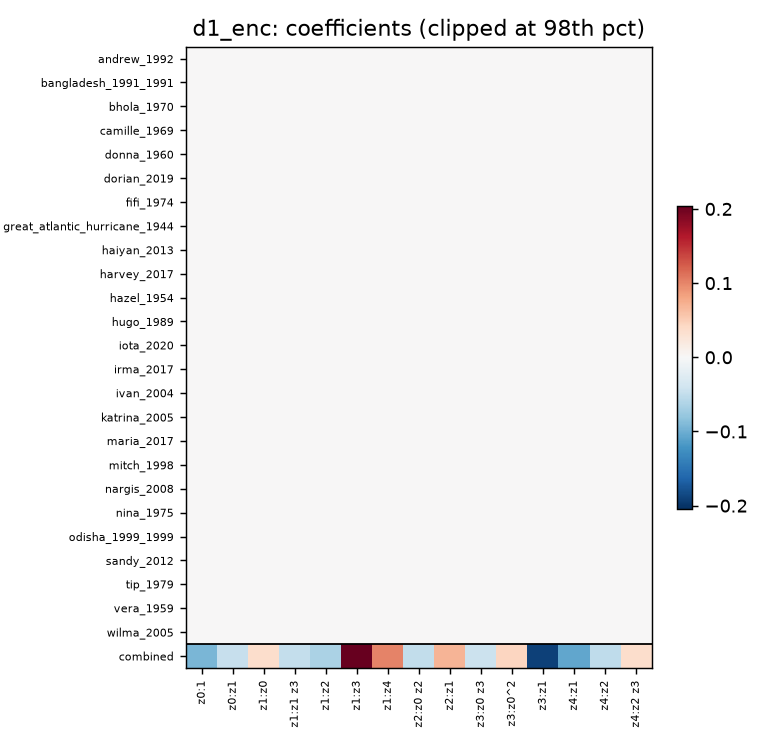

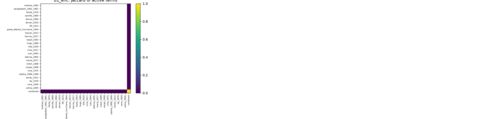

**6h_d1_bb / d1_bb**

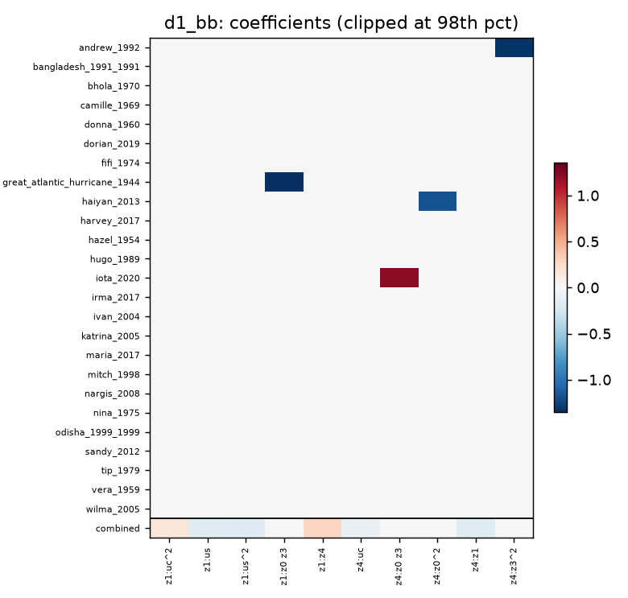

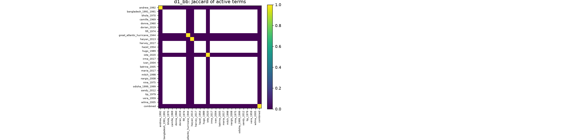

**6h_d2 / d2_enc**

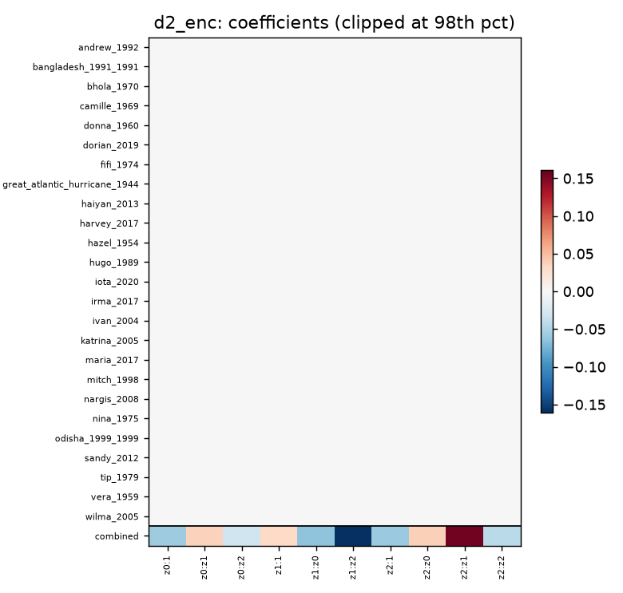

**6h_d2 / d2_bb**

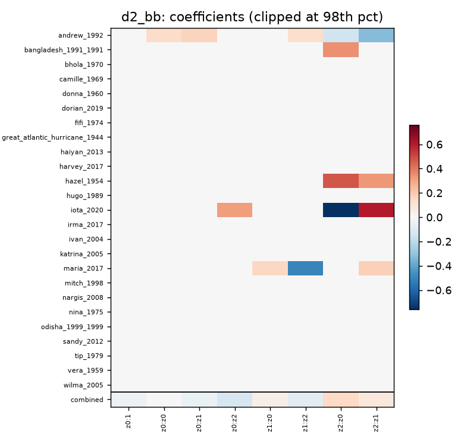

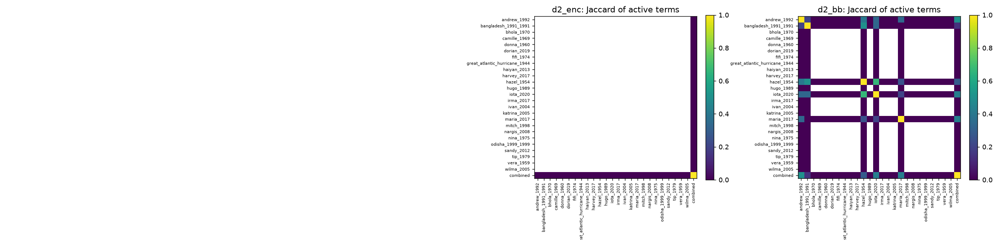

**discrete_k5 / d1_enc**

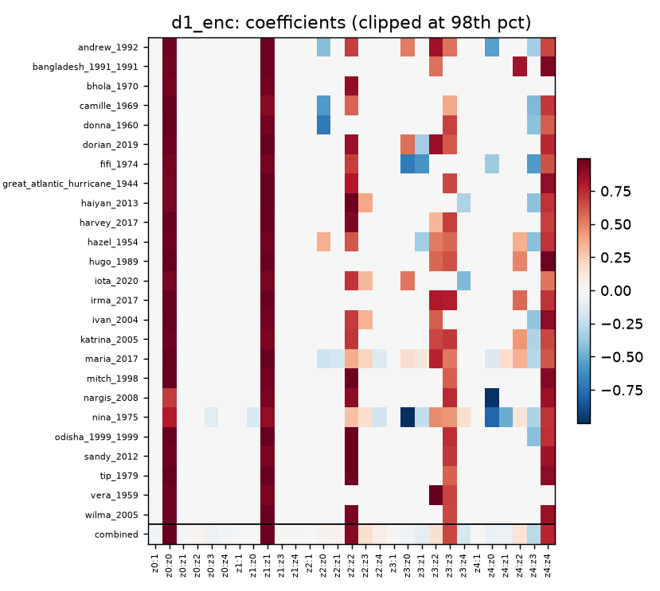

**discrete_k5 / d1_bb**

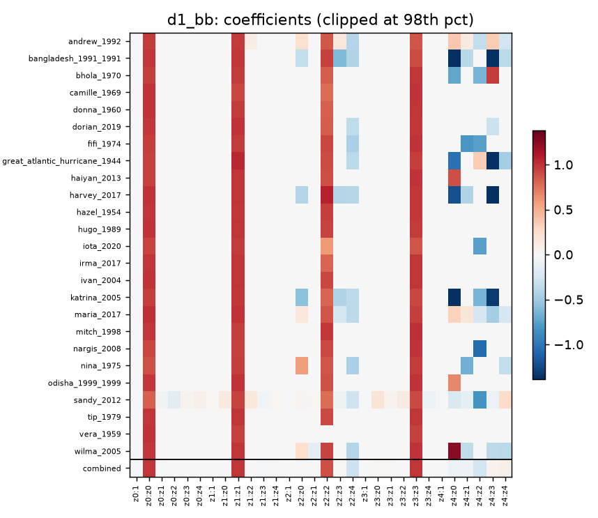

**discrete_k5 / d2_bb**

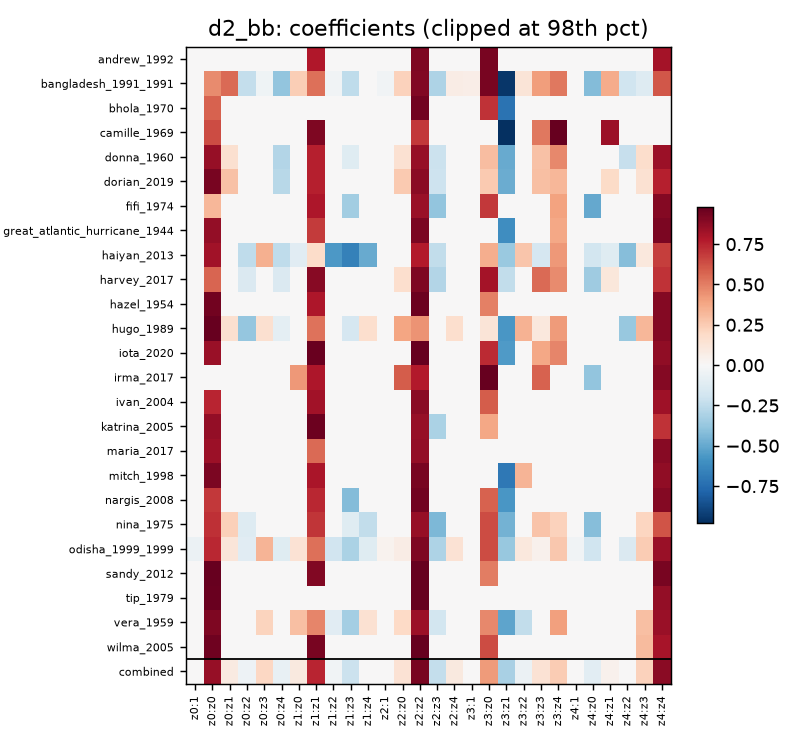

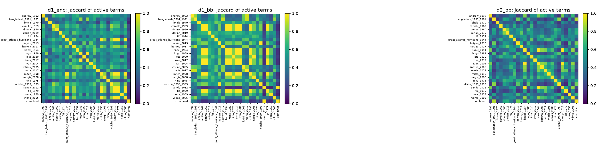

**discrete_k3 / d2_enc**

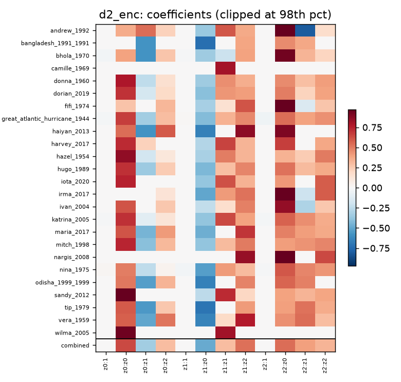


## Pre-1979 vs post-1979

> **Caveat:** the discrete-time R2 values (`discrete_k5`, `discrete_k3`) reflect a fixed 00/06/12/18 UTC time-of-day pattern, not storm dynamics; the signal vanishes with the per-hour mean removed (see `geo_ft/sindy_study/discrete_event_diurnal_check.md` in the code repo).

Pre-1979 (n=8): bhola_1970, camille_1969, donna_1960, fifi_1974, great_atlantic_hurricane_1944, hazel_1954, nina_1975, vera_1959. Post-1979 (n=17): the other 17, including tip_1979. Split by the year in the event name. Mann-Whitney p compares the two groups' held-out R2 (own / combined); with 8 vs 17 events the power is low.

| run | combo | group | n | non-empty | median active | median own ho R2 | own beats baseline | median combined ho R2 | combined beats baseline | median Jaccard vs combined | MWU p (own / combined) |
|---|---|---|---|---|---|---|---|---|---|---|---|
| 6h_d1_enc | d1_enc | pre-1979 | 8 | 0 | 0.0 | -0.190 | 0/0 | -0.212 | 1/8 | n/a |  |
| 6h_d1_enc | d1_enc | post-1979 | 17 | 0 | 0.0 | -0.303 | 0/0 | -0.207 | 2/17 | n/a | 0.47 / 0.80 |
| 6h_d1_bb | d1_bb | pre-1979 | 8 | 1 | 0.0 | -0.605 | 0/1 | -0.555 | 1/8 | 0.000 |  |
| 6h_d1_bb | d1_bb | post-1979 | 17 | 3 | 0.0 | -0.308 | 0/3 | -0.230 | 3/17 | 0.000 | 0.67 / 0.37 |
| 6h_d2 | d2_enc | pre-1979 | 8 | 0 | 0.0 | -0.122 | 0/0 | -0.142 | 2/8 | n/a |  |
| 6h_d2 | d2_enc | post-1979 | 17 | 0 | 0.0 | -0.100 | 0/0 | -0.105 | 6/17 | n/a | 0.93 / 0.55 |
| 6h_d2 | d2_bb | pre-1979 | 8 | 1 | 0.0 | -0.316 | 0/1 | -0.048 | 2/8 | 0.286 |  |
| 6h_d2 | d2_bb | post-1979 | 17 | 4 | 0.0 | -0.189 | 1/4 | -0.238 | 4/17 | 0.429 | 0.44 / 0.47 |
| discrete_k5 | d1_enc | pre-1979 | 8 | 6 | 2.0 | -0.701 | 2/6 | 0.166 | 6/8 | 0.224 |  |
| discrete_k5 | d1_enc | post-1979 | 17 | 13 | 2.0 | -0.425 | 2/13 | 0.134 | 11/17 | 0.207 | 0.55 / 0.59 |
| discrete_k5 | d1_bb | pre-1979 | 8 | 4 | 1.5 | -0.088 | 2/4 | 0.097 | 5/8 | 0.183 |  |
| discrete_k5 | d1_bb | post-1979 | 17 | 12 | 1.0 | -0.086 | 3/12 | 0.070 | 14/17 | 0.167 | 0.84 / 0.84 |
| discrete_k5 | d2_bb | pre-1979 | 8 | 8 | 4.0 | 0.031 | 5/8 | 0.296 | 8/8 | 0.364 |  |
| discrete_k5 | d2_bb | post-1979 | 17 | 15 | 3.0 | -0.009 | 6/15 | 0.323 | 15/17 | 0.318 | 0.93 / 0.75 |
| discrete_k3 | d2_enc | pre-1979 | 8 | 7 | 6.0 | 0.368 | 7/7 | 0.516 | 7/8 | 0.819 |  |
| discrete_k3 | d2_enc | post-1979 | 17 | 16 | 5.0 | 0.466 | 13/16 | 0.502 | 15/17 | 0.778 | 0.55 / 0.98 |

